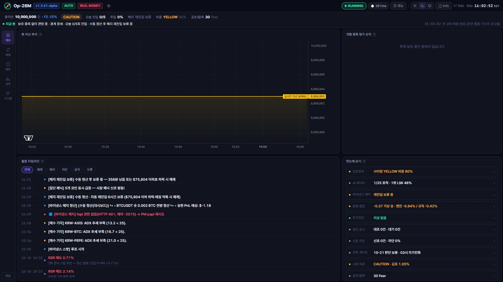
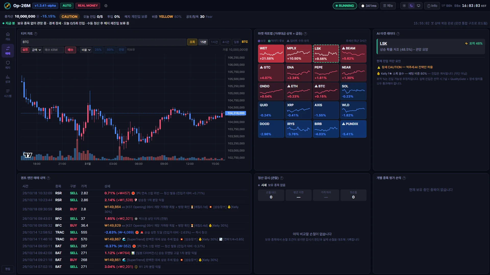
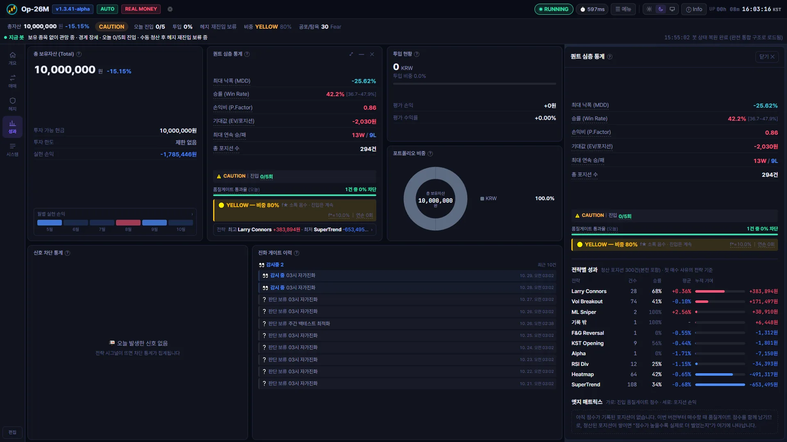
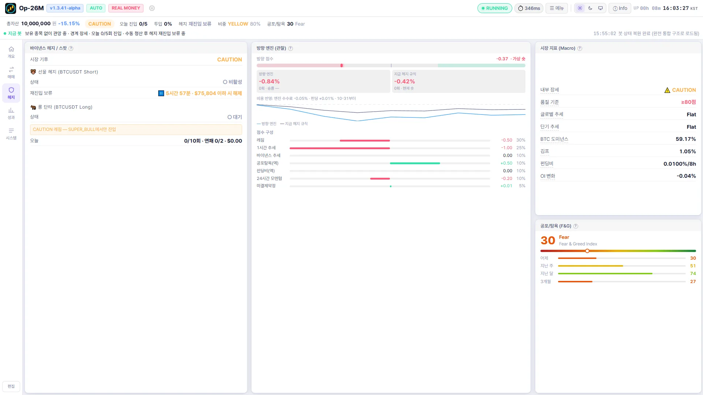
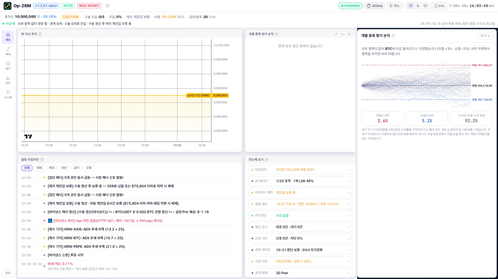

# 🚀 Op-26M Quant Master
### 스스로 진화하는 완전 자동화 AI 퀀트 트레이딩 엔진

<i>Institutional-grade automated crypto trading engine for Upbit & Binance — self-evolving, self-defending.</i>

 

**⭐ 이 프로젝트가 마음에 드셨다면 우측 상단 Star를 눌러주세요 — 업데이트 소식을 가장 먼저 확인하실 수 있습니다.**

---

## 📥 다운로드 및 설치

1. **[⬇️ 최신 버전 다운로드](https://github.com/jaeil-park/UpbitBot-Releases/releases/latest)** — `Op-26M_Master_Setup.exe`
2. 다운로드한 설치 파일을 실행합니다.
3. 바탕화면에 생성된 아이콘으로 퀀트 엔진을 실행합니다.

> 최초 실행 시 라이선스 키 인증이 필요합니다. 문의는 [카카오톡 오픈채팅](https://open.kakao.com/o/syAcmtug)으로 연락 주세요.

### 🔄 자동 업데이트 (OTA)
설치 후에는 신경 쓸 필요가 없습니다. 새 버전이 릴리즈되면 백그라운드에서 자동으로 감지하여 무인 설치(Silent Install)됩니다.

---

## ✨ 핵심 기능

| 기능 | 설명 |
| :--- | :--- |
| 🧠 **ML Sniper** | XGBoost 기반 머신러닝이 실시간 시장 데이터를 분석해 매수 확률(%)을 추론 |
| 🧬 **자가 진화 엔진** | 매일 새벽 3시, 실거래·섀도우 백테스트 데이터를 복기해 수익 나는 전략만 남기고 스스로 진화 |
| 🛡️ **6단계 진입 품질 필터** | 멀티 타임프레임 추세 · BTC 동조화 · 거래량 신뢰도 · ATR 활성 · 시장 기후 · 2봉 연속 시그널 확인 |
| ⛔ **서킷브레이커** | 일일 15건 / 시간당 3건 / 3연속 손절 시 자동 냉각 구간 진입으로 과매매 차단 |
| 📉 **동적 ATR 손절** | 코인별 실시간 변동성 반영, 손익비 2:1 미만 진입 자체 거부 |
| 🔥 **주도주 별동대 (히트맵 엔진)** | 메인 봇과 독립 구동, 당일 최고 모멘텀 코인에 진입 후 매일 08:55 전량 현금화 |
| ☁️ **클라우드 동기화** | PC를 옮겨도 1초 만에 매매 내역·자산 상태 완벽 복원 (Supabase) |
| 🛰️ **바이낸스 헤지** | 장세가 나빠지면 BTC 선물 숏으로 업비트 현물 노출을 자동 헤지, 수동 청산 후 재진입 보류 |
| 📢 **업비트 경보 감시** | 가격 급등락·거래량/입금량 급증·해외 가격 차이 등 업비트 주의·유의 지정을 5분마다 수집해 화면과 타임라인에 표시 |
| 📓 **노션 매매일지 (선택)** | 포지션이 청산될 때마다 노션 표에 전략·손익·진입 점수·청산 사유와 복기 메모 칸을 자동 기록 |
| 📊 **실시간 대시보드** | 개요·매매·헤지·성과·시스템 작업공간 탭, 위젯 상세 서랍, 라이트/다크/시스템 테마, 안전장치 현황 모니터링 및 강제 해제 |

전체 기능/아키텍처는 [소스 저장소 README](https://github.com/jaeil-park/UpbitBot#readme)에서 더 자세히 확인하실 수 있습니다. *(본 저장소는 빌드된 실행 파일 배포 전용이며, 소스코드는 저작권 등록된 독점 소프트웨어로 비공개입니다.)*

---

## 🖥️ 대시보드 미리보기

> 아래 화면은 실제 실행 중인 봇을 **데모 모드**로 찍은 것입니다. 수익률·전략 통계·차트는 실제 그대로이고, 원화 금액만 총자산 1,000만 원 기준으로 환산했습니다.

**개요** — 상단 상태 바에 총자산·장세·오늘 진입·헤지·비중이 한 줄로, 그 아래 '지금 봇이 하는 일'. 자산 추이·활동 타임라인(매매·헤지·차단·공지·오류)·한눈에 보기를 한 화면에서 봅니다.

📸 더 많은 화면 보기 (매매 / 성과 / 헤지 / 몬테카를로)

 

| | |
| :---: | :---: |
|  |  |
| **매매** — 차트 스캐너(종목별 3시간 추세선·AI 레이더 후보·⚠ 업비트 경보), 티커 차트, 매매 내역 | **성과** — 손익 달력, 퀀트 통계, 오른쪽 서랍에 전략별 성과와 엣지 매트릭스 |
|  |  |
| **헤지** — 바이낸스 헤지 상태, 롱/숏 방향 엔진(관찰), 시장 지표·공포탐욕 | **몬테카를로** — 최근 변동성으로 12시간 경로 2,000개를 그려 익절선·손절선 도달 확률 표시 |

---

## 📝 최근 업데이트

전체 변경 이력은 **[Releases](https://github.com/jaeil-park/UpbitBot-Releases/releases)** 탭에서 버전별로 확인하세요.

<!-- 최근 릴리즈 요약: 필요 시 이 섹션을 새 릴리즈에 맞춰 갱신하세요 -->
- **v1.3.41** — 노션 매매일지(선택, 최초 안내 팝업), 숫자 변화·목록·서랍 애니메이션
- **v1.3.40** — 전략별 성과·엣지 매트릭스, 손익 달력, 차트 스캐너, 몬테카를로 확률, 업비트 주의·유의 경보
- **v1.3.39** — 대시보드를 작업공간 탭으로 개편, 상단 상태 바, 상세 서랍, 활동 타임라인, 라이트/다크/시스템 테마
- **v1.3.38** — 헤지 수동 청산 후 재진입 보류, 롱/숏 방향 엔진(관찰), 헤지 손실 한도, 대시보드 전송량 감소
- **v1.3.37** — 라이선스 서버 장애 시에도 정상 시작 (72시간 유예)

---

## 💬 고객 지원 및 라이선스 문의

- **상담 채널:** [카카오톡 오픈채팅](https://open.kakao.com/o/syAcmtug)
- **운영 시간:** 평일 09:00 ~ 18:00
- **블로그/기술 아티클:** [infralog.kr](https://infralog.kr) · [Tistory](https://jaeil-boxs.tistory.com)

---

Copyright © 2026 HaeWooSo & jipark. All rights reserved.
본 소프트웨어는 대한민국 저작권법에 의거하여 보호받는 독점(Proprietary) 소프트웨어입니다.

